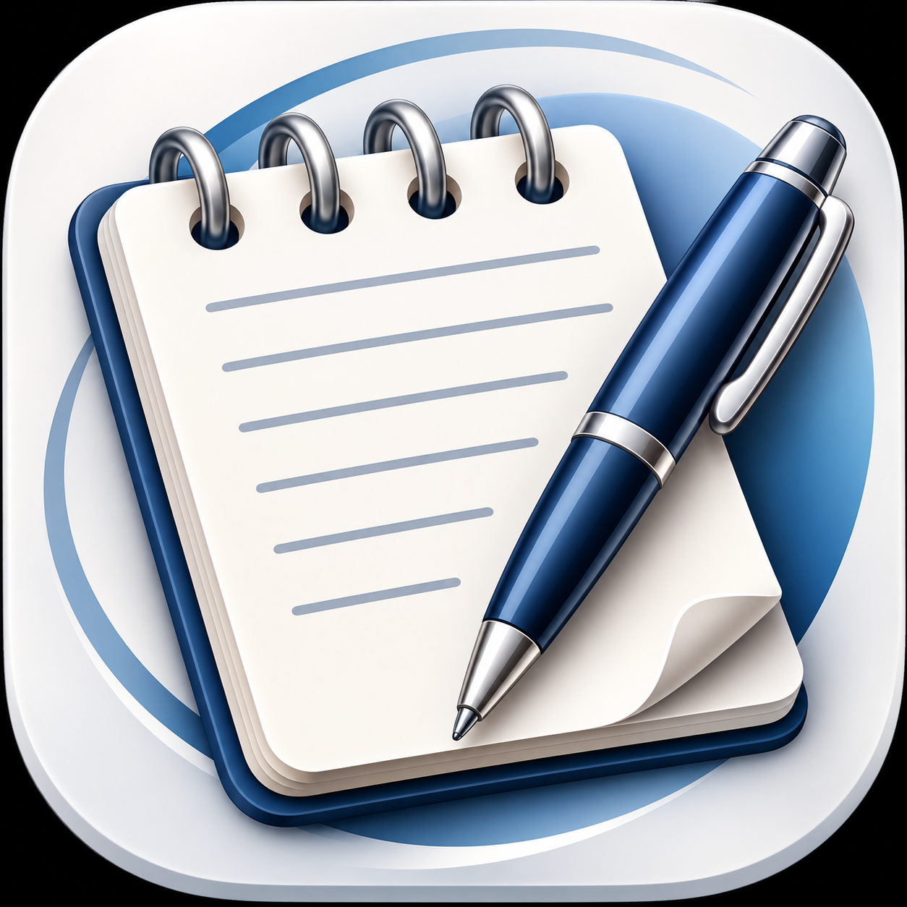

#  Meine Notizen (Build by KI)

**Notizen schnell erfassen – ohne Markdown-Kenntnisse, auf Wunsch aber komplett in Markdown.**


-6c5ce7)

„Meine Notizen“ ist eine Notiz-App für Android und iOS. Sie funktioniert **eigenständig** – alle Notizen liegen lokal auf dem Gerät und sind auch ohne Internet verfügbar. Wer eine eigene Instanz von **[Memos](https://usememos.com)** (usememos) betreibt, kann die App zusätzlich mit diesem Server **synchronisieren**.

> ⚠️ **Mindestanforderung:** Die Synchronisierung funktioniert erst ab **Memos 26.10.0**. Ältere Memos-Versionen werden nicht unterstützt.

Das Hauptaugenmerk liegt auf einer **leichten Erfassung**: Listen, Aufgaben und Überschriften legst du per Knopfdruck an – ganz ohne Markdown zu kennen. Wer Markdown mag, schaltet in den **Editor** um und schreibt alles direkt als Markdown-Text.

> 📖 Die technische Beschreibung des Codes findest du auf einer eigenen Seite: **[Code-Dokumentation → docs/DOKUMENTATION.md](docs/DOKUMENTATION.md)**

---

## Inhaltsverzeichnis

1. [Was kann die App?](#was-kann-die-app)
2. [Ein Beispiel](#ein-beispiel)
3. [Mit Memos synchronisieren](#mit-memos-synchronisieren)
4. [Entwickelt mit Flutter](#entwickelt-mit-flutter)
5. [Installation der Entwicklungsumgebung](#installation-der-entwicklungsumgebung)
6. [App starten und bauen](#app-starten-und-bauen)
7. [Projektstruktur](#projektstruktur)
8. [Dokumentation](#dokumentation)

---

## Was kann die App?

- 📝 **Notizen erfassen und bearbeiten** – neue Notiz mit einem Tipp, Änderungen werden automatisch gespeichert.
- 👀 **Ansicht und Editor** – in der **Ansicht** siehst du die fertig formatierte Notiz und bearbeitest Listen direkt; im **Editor** schreibst du reines Markdown mit praktischer Werkzeugleiste.
- ✅ **Listen ohne Markdown** – Aufgaben mit Checkbox, Aufzählungen und Nummerierungen legst du über „Eintrag hinzufügen“ an. Einträge lassen sich direkt in der Zeile bearbeiten, per Drag-and-drop umsortieren und verschachteln (Unteraufgaben).
- 🔁 **Erledigtes aufgeräumt** – erledigte Aufgaben wandern in einen eigenen, einklappbaren Bereich „Erledigt“. Hauptaufgabe und Unteraufgaben werden gemeinsam erledigt bzw. wieder geöffnet.
- 🔎 **Keine Doppelten** – tippst du einen Eintrag, den es in der Notiz schon gibt, schlägt die App den vorhandenen vor und öffnet ihn auf Wunsch wieder, statt ihn doppelt anzulegen.
- 🖊️ **Markdown-Werkzeugleiste** – Rückgängig, Überschrift 1/2, normaler Text, fett, kursiv, Aufzählung, Nummerierung, Aufgabe, Link, Code und Zitat.
- 🗂️ **Übersicht als Karten** – jede Notiz zeigt Überschrift und die ersten Zeilen in der Ansicht, damit du sofort erkennst, worum es geht.
- 🔎 **Notizen suchen** – die Suche auf der Startseite filtert alle aktiven Notizen; beim Hinzufügen einer Verknüpfung kann ebenfalls nach Notizen gesucht werden.
- 🔗 **Notizen verknüpfen** – verknüpfte Memos werden in der Notiz angezeigt. Verknüpfungen lassen sich über die Suche hinzufügen und wieder entfernen.
- 🧭 **Archiv, Bereiche, Ansichten und Tags** – Notizen archivieren, Memos-Bereichen zuordnen und eigene lokale Filteransichten anlegen.
- 📌 **Notizen organisieren** – anheften, einem Bereich zuordnen und Tags direkt über das Seitenmenü filtern.
- 📎 **Anhänge und Medien** – Dateien, Bilder, Zeichnungen/Markierungen, Audioaufnahmen und den aktuellen Standort zu einer Notiz hinzufügen.
- 📴 **Offline-first** – Notizen werden lokal gespeichert; nicht synchronisierte Notizen sind mit einem Wolken-Symbol markiert.
- 🔄 **Sync mit Memos** – optional, mit Server-URL und Access Token. Siehe [unten](#mit-memos-synchronisieren).
- 📱 **Homescreen-Widget (Android)** – zeigt eine Auswahl deiner Notizen und springt per Tipp direkt in die Notiz. Über das „+“ im Widget legst du eine neue Notiz an.
- 🌗 **Hell, Dunkel oder System** – das Erscheinungsbild stellst du in den Einstellungen ein.
- 🔐 **Token sicher abgelegt** – im Android Keystore bzw. in der iOS Keychain, nicht im Klartext.

---

## Ein Beispiel

**Ohne Markdown:** Du tippst auf „Eintrag hinzufügen → Aufgabe hinzufügen“, schreibst „Milch“, „Brot“ und „Eier“ und hakst sie beim Einkaufen ab.

**Mit Markdown:** Im Editor schreibst du dasselbe so:

```markdown
# Einkauf

- [ ] Milch
- [ ] Brot
- [x] Eier
```

Beide Wege führen zum selben Ergebnis – du kannst jederzeit zwischen **Ansicht** und **Editor** wechseln. In Memos landet die Notiz als ganz normaler Markdown-Text und ist dort ebenfalls lesbar.

---

## Mit Memos synchronisieren

Die App funktioniert auch ohne Server. Möchtest du deine Notizen mit deiner eigenen Memos-Instanz abgleichen:

1. In Memos unter **Settings → My Account** einen **Access Token** erzeugen.
2. In der App: **Menü → Einstellungen** öffnen.
3. **Server-URL** eintragen (z. B. `https://memos.example.com`) und den Token einfügen.
4. **Testen & speichern** tippen – die App prüft die Verbindung und startet die erste Synchronisation.

**Gut zu wissen**

- Neue Notizen werden in Memos als **privat** angelegt.
- **Bereiche** verwenden Memos-Spaces und sind nur sichtbar, wenn der Server die Spaces-API unterstützt. Beim Verschieben in einen Bereich wird die Notiz für dessen Mitglieder sichtbar; beim Entfernen wird die vorherige Sichtbarkeit wiederhergestellt.
- Archiv, Anheften und Anhänge werden mit Memos synchronisiert. **Ansichten** werden lokal auf dem Gerät gespeichert.
- Memo-Verknüpfungen werden als Memos-Referenzbeziehungen synchronisiert und benötigen eine Instanz mit Relations-API-Unterstützung.
- Unterstützt werden Memos ab Version **26.10.0**. Die App verwendet ab dieser Version die API-Pfade ohne `v1`-Präfix, zum Beispiel `/api/memos`.
- Datei-, Kamera-, Mikrofon- und Standortberechtigungen fragt das Betriebssystem bei Bedarf ab. Unbekannte Dateitypen werden in der App nicht ausgeführt oder außerhalb der App geöffnet.
- Änderungen werden lokal sofort gespeichert und kurz nach dem Tippen bzw. beim Verlassen der Notiz und beim Wechsel in den Hintergrund zum Server gesendet.
- Mit Ziehen nach unten auf der Startseite oder dem Sync-Symbol startest du die Synchronisation manuell.
- Der Schalter **HTTPS verwenden** setzt das Schema in der URL-Zeile. HTTP ist nur für vertrauenswürdige Netzwerke (z. B. Heimnetz) gedacht – der Token wird dann unverschlüsselt übertragen, die App warnt davor.
- **Server-URL & Token löschen** entfernt die Zugangsdaten vom Gerät. Lokale Notizen bleiben erhalten.
- Wurde eine Notiz auf Gerät **und** Server geändert, gewinnt der lokale Stand. Details: [Synchronisation](docs/DOKUMENTATION.md#6-synchronisation).

---

## Entwickelt mit Flutter

Der gesamte Code ist in **[Flutter](https://flutter.dev)** (Programmiersprache **[Dart](https://dart.dev)**) geschrieben. Damit entsteht aus einer einzigen Codebasis eine App für **Android und iOS**. Das Widget ist nativ in **Kotlin** umgesetzt.

| Bereich | Eingesetzt |
|---------|-----------|
| Framework | [Flutter](https://flutter.dev) / [Dart](https://dart.dev) |
| State-Management | [provider](https://pub.dev/packages/provider) |
| Lokale Speicherung | SQLite-Offline-Cache (`sqflite`) + [shared_preferences](https://pub.dev/packages/shared_preferences) für Einstellungen |
| Token-Speicher | [flutter_secure_storage](https://pub.dev/packages/flutter_secure_storage) (Keystore / Keychain) |
| Server-Anbindung | [http](https://pub.dev/packages/http) → [Memos-API](https://usememos.com/docs/api/latest) |
| Markdown-Anzeige | [flutter_markdown](https://pub.dev/packages/flutter_markdown), Links über [url_launcher](https://pub.dev/packages/url_launcher) |
| Homescreen-Widget | [home_widget](https://pub.dev/packages/home_widget) + natives Android-Widget (Kotlin) |
| Log teilen | [share_plus](https://pub.dev/packages/share_plus) |

> ℹ️ **Hinweis zu iOS:** Das Widget ist bisher nur für Android umgesetzt. Für iOS fehlen die WidgetKit-Erweiterung (`NoteWidget`) samt App Group sowie der Eintrag des URL-Schemas `notizapp` in der `Info.plist`. Der Android-Build ist der aktuell vorgesehene Hauptweg.

---

## Installation der Entwicklungsumgebung

Wenn du den Code selbst ausführen oder weiterentwickeln möchtest, brauchst du die folgenden Werkzeuge.

### 1. Flutter SDK installieren

Die offizielle Anleitung deckt Windows, macOS und Linux ab:

👉 **<https://docs.flutter.dev/get-started/install>**

Das Flutter SDK bringt Dart bereits mit. Das Projekt benötigt eine aktuelle stabile Flutter-Version (siehe `pubspec.yaml`).

Prüfe die Installation anschließend im Terminal:

```bash
flutter --version
flutter doctor
```

`flutter doctor` zeigt dir, was noch fehlt (z. B. Android-Lizenzen oder Xcode).

### 2. Git installieren

Zum Herunterladen des Repositories: <https://git-scm.com/downloads>

### 3. Editor / IDE wählen

| Editor | Link | Zusätzlich nötig |
|--------|------|------------------|
| **Visual Studio Code** | <https://code.visualstudio.com> | [Flutter-Erweiterung](https://marketplace.visualstudio.com/items?itemName=Dart-Code.flutter) (installiert auch die Dart-Erweiterung) |
| **Android Studio** | <https://developer.android.com/studio> | Plugins *Flutter* und *Dart* |

Anleitung zur Editor-Einrichtung: <https://docs.flutter.dev/get-started/editor>

### 4. Für Android: Android-SDK einrichten

1. **Android Studio** installieren (<https://developer.android.com/studio>). Es bringt das Android SDK mit.
2. In Android Studio unter *Settings → Languages & Frameworks → Android SDK → SDK Tools* die **Android SDK Command-line Tools** installieren.
3. Android-Lizenzen akzeptieren:
   ```bash
   flutter doctor --android-licenses
   ```
4. **JDK 17** (oder neuer) wird für den Gradle-Build benötigt. Das von Android Studio mitgelieferte JDK reicht; alternativ z. B. [Eclipse Temurin](https://adoptium.net).

Offizielle Anleitung: <https://docs.flutter.dev/platform-integration/android/setup>

### 5. Für iOS (nur auf einem Mac)

1. **Xcode** aus dem Mac App Store installieren: <https://developer.apple.com/xcode/>
2. **CocoaPods** installieren: <https://guides.cocoapods.org/using/getting-started.html>
3. Xcode einmal starten und die Lizenz akzeptieren.

Offizielle Anleitung: <https://docs.flutter.dev/platform-integration/ios/setup>

### 6. Testgerät bereitstellen

- **Echtes Android-Handy:** Entwickleroptionen und USB-Debugging aktivieren, per USB anschließen.
- **Emulator:** in Android Studio über den *Device Manager* anlegen (<https://developer.android.com/studio/run/managing-avds>).
- **iOS-Simulator:** wird mit Xcode installiert.

---

## App starten und bauen

```bash
# 1. Repository klonen
git clone https://github.com/<dein-benutzername>/<dein-repository>.git
cd <dein-repository>

# 2. Abhängigkeiten laden
flutter pub get

# 3. Verfügbare Geräte anzeigen
flutter devices

# 4. App im Debug-Modus starten
flutter run
```

> 💡 In **VS Code** startest du die App alternativ mit `F5` und wählst unten rechts das Zielgerät aus.

**Release-Build für Android (APK):**

```bash
flutter build apk --release
```

Die fertige Datei liegt danach unter `build/app/outputs/flutter-apk/app-release.apk`.

**Release-Build für iOS (nur auf dem Mac):**

```bash
flutter build ios --release
```

> ⚠️ **Hinweise**
> - Die Datei `android/local.properties` enthält Pfade deines Rechners (SDK-Ordner). Flutter erzeugt sie automatisch; sie gehört **nicht** ins Git-Repository.
> - Der Release-Build ist derzeit mit dem Debug-Schlüssel signiert. Für eine Veröffentlichung (z. B. im Play Store) brauchst du eine eigene Signatur: <https://docs.flutter.dev/deployment/android>

Weitere Flutter-Grundlagen: <https://docs.flutter.dev/get-started/codelab>

---

## Projektstruktur

```
lib/
├── main.dart                 # Einstiegspunkt, Theme, Widget-Links, App-Lebenszyklus
├── models/                   # Datenmodelle (Notiz, Aufgabe, Markdown-Parser)
├── state/                    # State-Management (AppState: Notizen, Sync, Widget)
├── services/                 # Server-API, lokaler Speicher, Log
├── screens/                  # Bildschirme (Startseite, Notiz, Einstellungen)
└── widgets/                  # Wiederverwendbare Bausteine (Listen-Ansicht)

android/app/src/main/
├── kotlin/…/                 # MainActivity, Widget (Provider, Service, Aktions-Dialog)
├── res/                      # Layouts, Farben, Themes des Widgets
└── AndroidManifest.xml
```

Eine Beschreibung jeder einzelnen Datei findest du in der **[Code-Dokumentation](docs/DOKUMENTATION.md)**.

---

## Dokumentation

| Seite | Inhalt |
|-------|--------|
| 📖 [docs/DOKUMENTATION.md](docs/DOKUMENTATION.md) | Ausführliche Code-Dokumentation: Funktionen, Datenmodelle, Markdown-Parser, Synchronisation, lokale Speicherung, Widget, Sicherheit und Abhängigkeiten |

---

*Meine Notizen · für Memos (usememos)*
